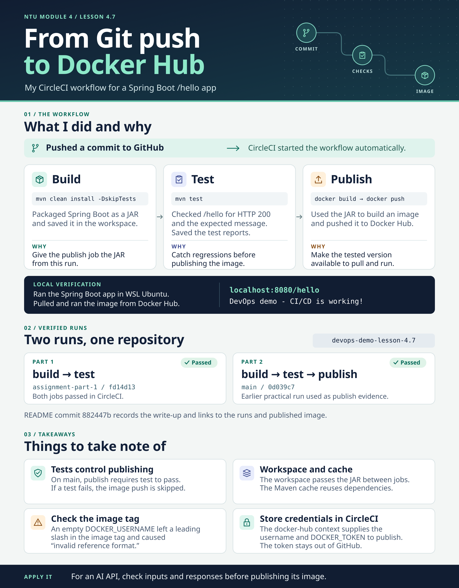

# devops-demo

## Getting started

Clone the repository:

```bash
git clone https://github.com/aie-devops/devops-demo.git
cd devops-demo
```

## Requirements

- Java 21 (JDK)
- Maven 3.9+

### Installing Java and Maven with SDKMAN

If you already have [SDKMAN](https://sdkman.io/) installed, install Java 21 and Maven with:

```bash
sdk install java 21.0.12.1-tem
sdk install maven
```

Then verify the versions:

```bash
java -version
mvn -version
```

## Running the app

```bash
mvn spring-boot:run
```

The app starts on [http://localhost:8080](http://localhost:8080) by default.

Alternatively, build a JAR and run it:

```bash
mvn clean package
java -jar target/devops-demo-0.0.1-SNAPSHOT.jar
```

## Running tests

```bash
mvn test
```

## Working with tagged stages

This repo uses tags (e.g. `step-1-project-template`, `step-2-example`, ...) to mark different stages of the app as it evolves. To see all available tags:

```bash
git tag -l
```

To work from a specific stage, create a new branch starting at that tag:

```bash
git checkout -b my-branch-name step-1-project-template
```

This checks out the code exactly as it was at that tag and puts you on a new branch (`my-branch-name`) so you can make changes without affecting the tag or other branches.

The `build` job uses Maven to package the Spring Boot application as a JAR and saves it in the CircleCI workspace. The `test` job runs the automated tests, including a check that `/hello` returns HTTP 200 and the expected message. On `main`, the `publish` job retrieves the JAR, builds a Docker image, and pushes it to Docker Hub. CircleCI supplies `DOCKER_USERNAME` and `DOCKER_TOKEN` through the `docker-hub` context, keeping the token out of the GitHub repository. Tests run before publishing so that if a test fails, CircleCI skips the publish job and no new image is pushed.

- [Part 1 build and test run (`fd14d13`)](https://app.circleci.com/workflow/9c341920-8b25-4f64-88ff-4e15b445a879)
- [Part 2 build, test, and publish checks (`0d039c7`)](https://github.com/Jefkong77/devops-demo-lesson-4.7/commit/0d039c7)
- [Published Docker Hub image](https://hub.docker.com/r/jefkong77/devops-demo-lesson-4.7/tags)

## Lesson 4.7 Assignment Infographic

